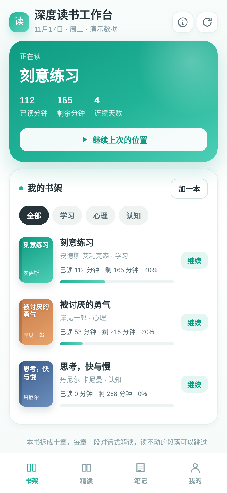
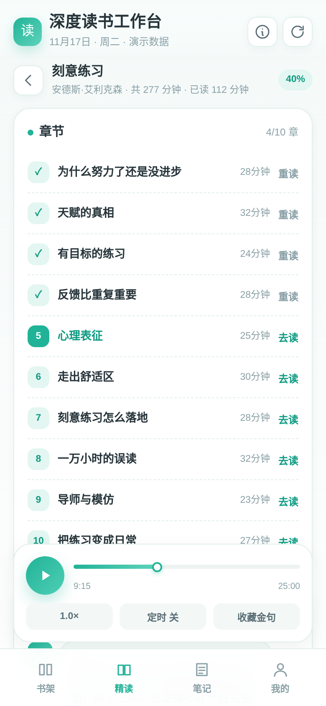
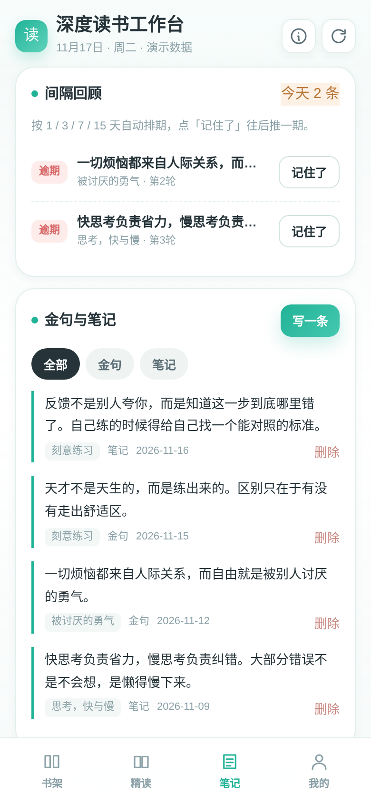

# 深度读书工作台

一本书十章，每章用两个人的对话讲明白。

单文件 HTML，双击就能用，离线可用，数据只存本机。





## 设计思路

直接读原著容易卡在概念上，听别人讲又太碎。这个工作台的做法是：每章先由「老张」抛出生活里的具体困惑，比如练了三年吉他还是弹不好；再由「小艾」用书里的观点回答，并标出关键概念。读完一段对话，比读完一章原文轻松，也比看十分钟视频记得住。

## 能做什么

- **书架**：正在读的书、已读分钟、剩余分钟、连续天数，每本显示十章进度
- **精读**：章节列表加对话正文，金句卡片可收藏
- **播放器**：可拖进度条、切倍速、设定时，读到哪一章自动保存
- **笔记**：金句和笔记分类展示，按 1/3/7/15 天间隔回顾，逾期标红
- **统计**：累计分钟、读完本数、笔记条数、本月目标

## 怎么用

1. 下载 `deep-reading-workbench.html`
2. 双击用浏览器打开，手机关联打开同一个文件
3. 首次是演示数据：三本书各十章，外加四条笔记
4. 点「加一本书」可以加自己的书，章节名在 `CHAP_NAMES` 里改

## 数据在哪

localStorage，键名 `deep_read_wb_v1`。清缓存会丢，记得在「我的」页导出 JSON。

## 已知限制

- 播放器是交互演示，没有接语音合成：进度、章节完成、收藏都是真实的，只是不出声
- 章节时长是参考值，不是真实朗读时长
- 回顾排期按自然日算

## 文件结构

```
deep-reading-workbench.html   程序本体，44KB
screenshots/                  三张界面截图
LICENSE
```

## 许可

MIT，可自由用于个人学习与二次修改，转载或商用请先联系作者。
